<p align="center">
  
</p>

<h1 align="center">RODAR Mobile</h1>

<p align="center">
  <a href="https://github.com/rodarglobal/rodar-mobile/actions/workflows/ci.yml"></a>
</p>

<p align="center">
  <strong>O agente de voz que conecta motorista, recebedor e central de operação (CCO).</strong><br />
  Este repositório é o <strong>app do motorista</strong> (Android, Expo + React Native), com o <strong>AvisAI</strong> na cabine.
</p>

<p align="center">
  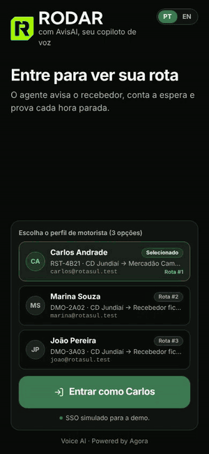
</p>

<p align="center">
  <sub>Gravado no modo Mock, com dados fictícios. GPS, recebedor e voz são simulados nesta gravação; para gravar, o app rodou no navegador em tamanho de celular.</sub><br />
  <sub>▶️ <a href="docs/assets/readme/tour.mp4">Ver em vídeo (MP4, 1 min)</a></sub>
</p>

## Para o júri

| | |
|---|---|
| **Trilha** | Logística & automação |
| **Em uma frase** | Um agente de voz que avisa o recebedor antes da chegada, conta a estadia do caminhão parado (Lei 11.442) e só chama a central quando alguém precisa decidir. |
| **Ver sem instalar nada** | [tour do app (1 min)](docs/assets/readme/tour.mp4) · [tour do site e do painel (1 min)](https://github.com/rodarglobal/rodar-web/blob/main/docs/assets/readme/tour.mp4) · [validação ponta a ponta com a API real: 33 de 33 etapas](https://github.com/rodarglobal/rodar-backend/blob/main/evidence/validacao.md) · [telas do app](#telas-do-aplicativo) |
| **Repositórios** | [rodar-backend](https://github.com/rodarglobal/rodar-backend) · [rodar-web](https://github.com/rodarglobal/rodar-web) · [rodar-mobile](https://github.com/rodarglobal/rodar-mobile) (este) |
| **Qualidade** | CI em cada repositório com lint e testes (e typecheck nos fronts) · 524 testes automatizados: 299 no backend, 127 no web, 98 no mobile |
| **Segurança** | JWT assinado no login, papel `cco` nas ações da central, CORS restrito, segredo do LLM e limite de ligações ([detalhes](https://github.com/rodarglobal/rodar-backend#segurança)) |
| **O que é simulado** | login sem senha, GPS da rota, documentos fiscais e o modo Mock do app: [lista completa](#o-que-é-simulado) |
<!-- Demo publicada e vídeo de 3 min do Hack Brasil: incluir as duas linhas aqui antes de 30/11. -->

## Para que serve

O motorista dirige; o AvisAI fala por ele. O app fica na cabine, recebe a rota que o CCO publicou e transforma cada momento da viagem em um evento com horário e prova, sem o motorista digitar nada com o caminhão andando.

| | Pilar | Como o app entrega |
|---|---|---|
| 🎙️ | **Mãos no volante** | Retirada, chegada, ocorrências e descarga são confirmadas por voz. Com o caminhão andando, o app aceita só voz; telas de leitura (documentos, mensagens) esperam o caminhão parar. |
| 📞 | **Recebedor avisado antes** | A 8 km do destino, o agente liga para o recebedor. A resposta (doca e horário, "não recebe hoje" ou "não atendeu") chega ao motorista em voz e num aviso na tela. |
| ⏱️ | **Cada hora parada provada** | Na chegada, o tempo parado começa a contar. A tela mostra a franquia de 5 h (Lei 11.442), a estadia acumulada e os avisos ao CCO. Cada evento guarda o horário do celular e o do servidor. |
| 📶 | **Funciona sem sinal** | Toda escrita entra numa fila local (`outbox`) com `idempotencyKey` e sobe em ordem quando a rede volta. Sem rede, as falas do motorista são guardadas e o AvisAI as processa depois. |
| 📄 | **Documentos na voz** | NF-e, CT-e e anexos do CCO ficam no celular. O agente responde só com o que está nos campos do documento, e "não encontrei" quando o campo não existe. |

## Como funciona

O fluxograma mostra uma viagem do ponto de vista do motorista. Em seguida, abra cada etapa para ver a tela correspondente.

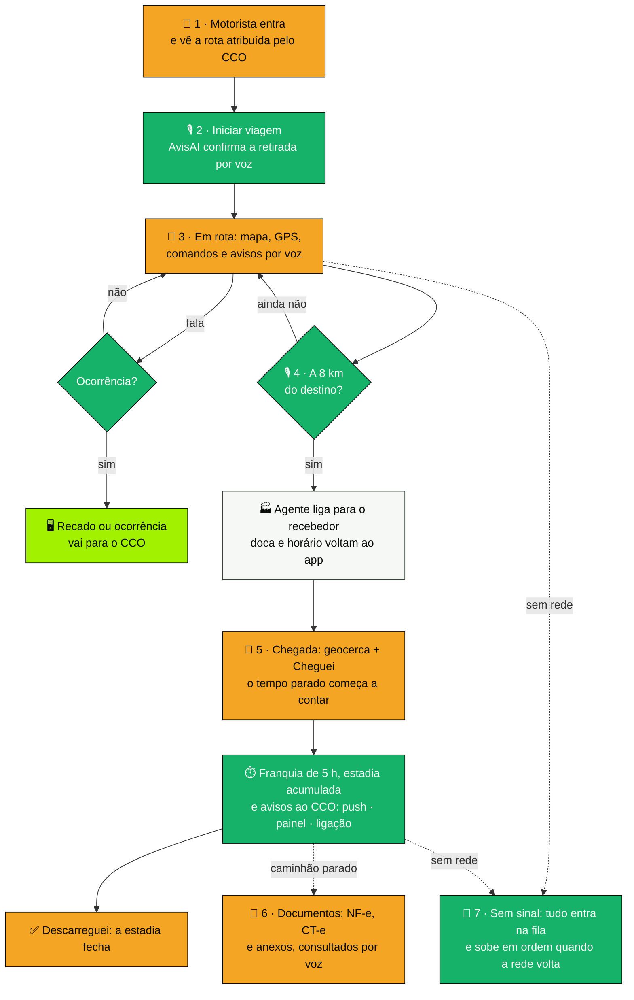

<sub>Cores por papel: 🟩 lima = CCO · 🟢 verde = agente de voz · 🟧 âmbar = motorista e caminhão · ⬜ claro = recebedor.</sub>

<details>
<summary><strong>1 · O motorista entra e vê a rota</strong> (Login e Início)</summary>
<br />

O login lista os perfis de motorista cadastrados no backend (no modo Mock, três perfis fictícios) e entra pelo SSO simulado. O Início mostra a próxima viagem que o CCO publicou: placa, origem, destino, janela de descarga e distância. A viagem começa pelo botão ou pela voz: *"Iniciar viagem, AvisAI!"*.

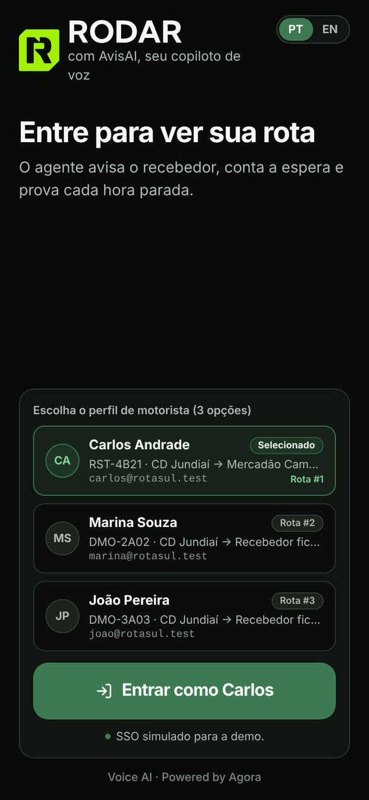
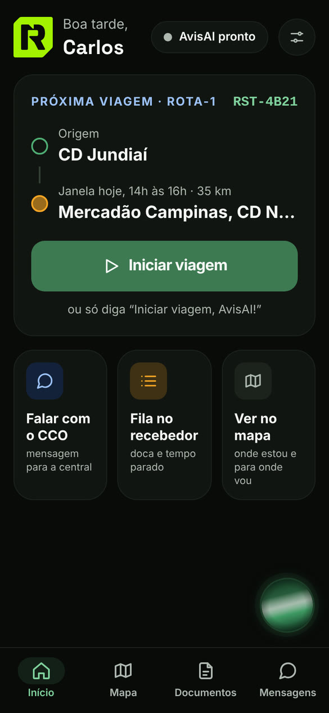
</details>

<details>
<summary><strong>2 · A retirada é confirmada por voz</strong> (AvisAI)</summary>
<br />

Ao iniciar a viagem, o AvisAI pergunta só o que falta para a retirada: a carga e o caminhão. A esfera flutuante abre o painel em qualquer tela; a conversa em tela cheia mostra o estado da voz, a latência e o modo viagem (só voz em movimento). No modo Mock, os chips simulam a fala do motorista.

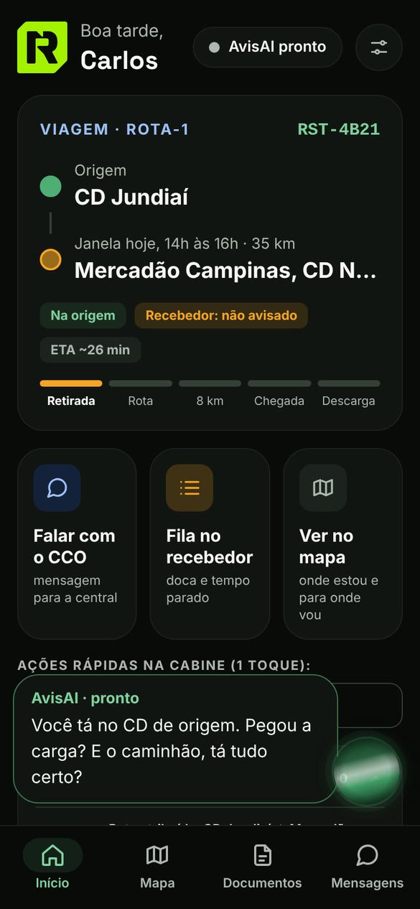
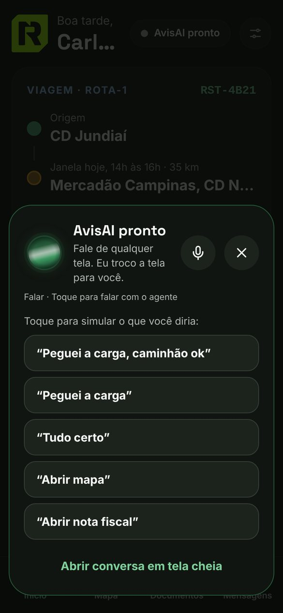
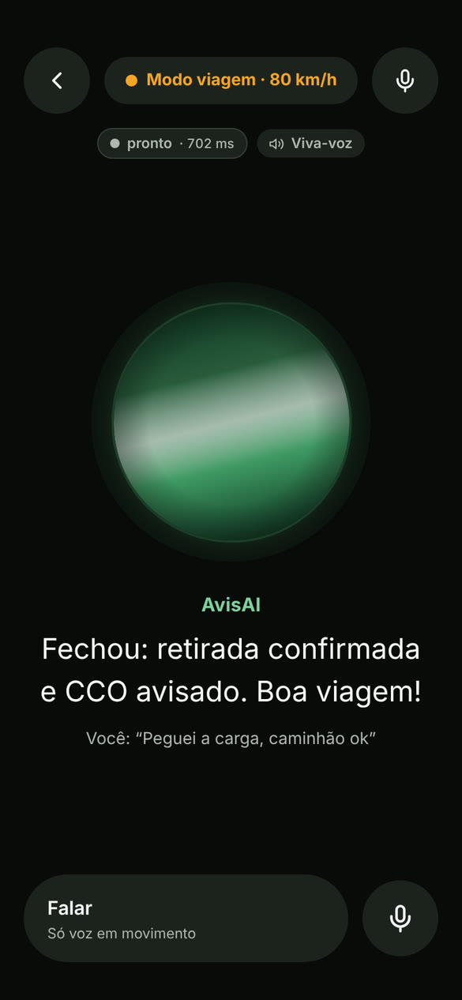
</details>

<details>
<summary><strong>3 · Em rota</strong> (Mapa e comandos de voz)</summary>
<br />

O Mapa mostra destino, distância, horário de chegada e as paradas, e o botão **Navegar** abre a rota no app de mapas do aparelho. Com a chave do Google Maps no Dev Build, o mapa é o Google; sem ela, um mapa SVG simulado (como na captura). Durante a viagem, o motorista pede telas, documentos e recados ao CCO por voz ([comandos](#comandos-de-voz-e-wake-word)).

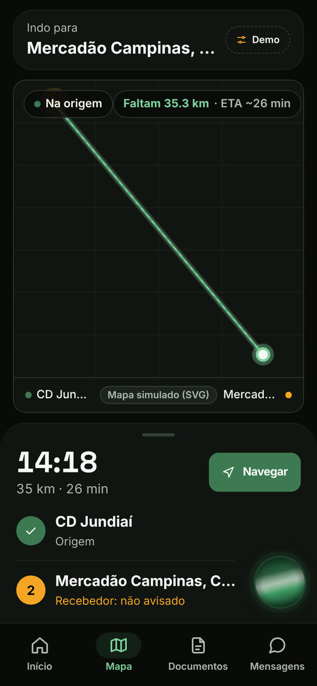
</details>

<details>
<summary><strong>4 · O recebedor é avisado a 8 km</strong></summary>
<br />

A 8 km do destino, o agente liga para o recebedor e pede doca e horário. A resposta chega ao motorista em voz e num aviso no topo da tela, e o selo da viagem passa a mostrar a doca confirmada. Se o recebedor não atende, a tentativa fica registrada como prova.

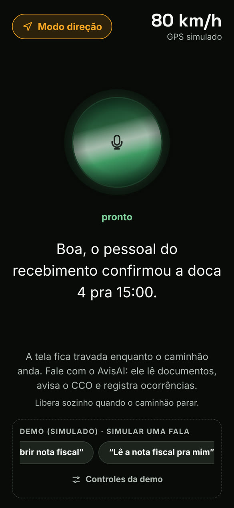
</details>

<details>
<summary><strong>5 · Chegada e prova da espera</strong> (Fila no recebedor)</summary>
<br />

A chegada é a entrada na geocerca do destino **e** o check-in por voz ou pelo botão **Cheguei**. O agente avisa o CCO e o tempo parado começa a contar. A Fila de descarga mostra a doca prevista, o tempo parado, a franquia de 5 h, a estadia acumulada e os avisos ao CCO (push, painel, ligação). **Descarreguei** encerra a estadia.

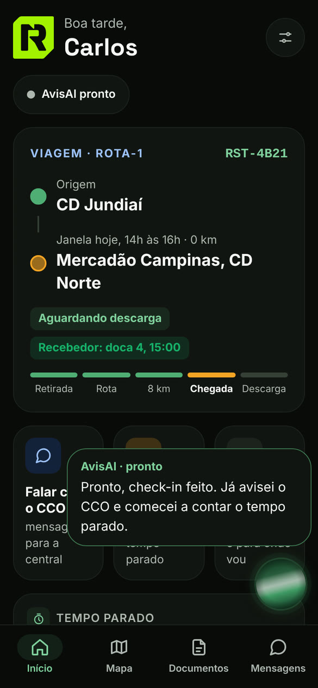
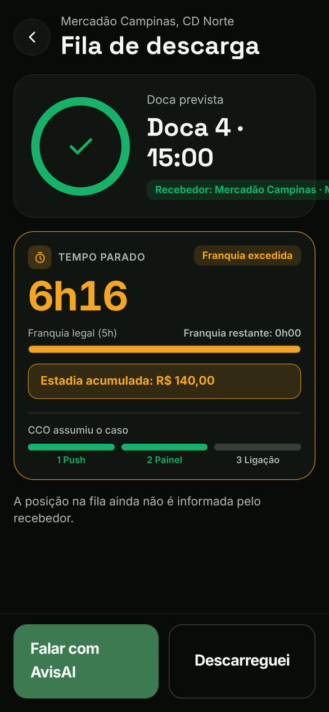

<sub>Na captura, o relógio da demo foi adiantado: 6h17 parado, 28 t, R$ 2,50 por t/h → 2 h excedentes × 28 t × R$ 2,50 = R$ 140,00.</sub>
</details>

<details>
<summary><strong>6 · Documentos guiados</strong></summary>
<br />

Documentos agrupa NF-e, CT-e e anexos enviados pelo CCO. O documento aberto mostra os campos verificados (número, peso, valor, emitente, destinatário, itens) e o botão para perguntar ao AvisAI. As respostas citam só esses campos.

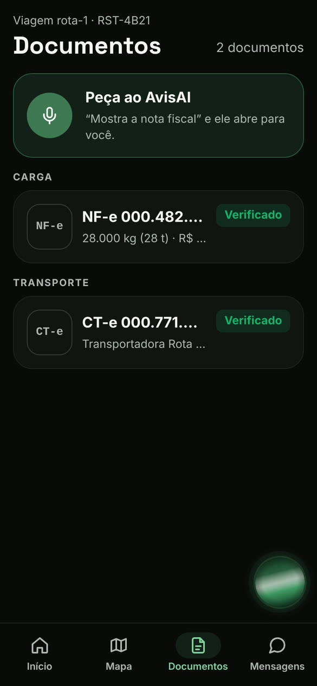
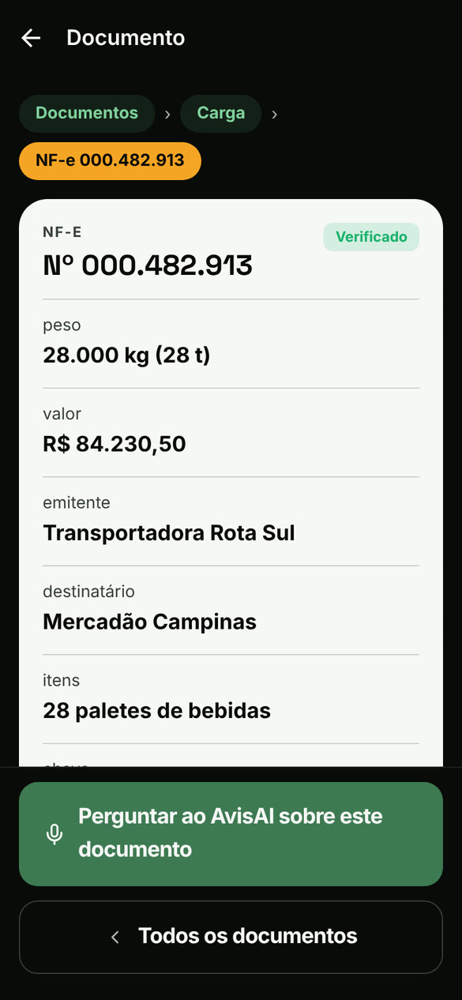
</details>

<details>
<summary><strong>7 · Sem sinal, nada se perde</strong> (Mensagens e fila offline)</summary>
<br />

Mensagens mostra o que foi enviado ao CCO e em que ponto do envio cada item está. Sem rede, uma faixa vermelha avisa e conta o que espera na fila. Com a conversa aberta e sem rede, cada fala vira um áudio que sobe quando a rede volta.

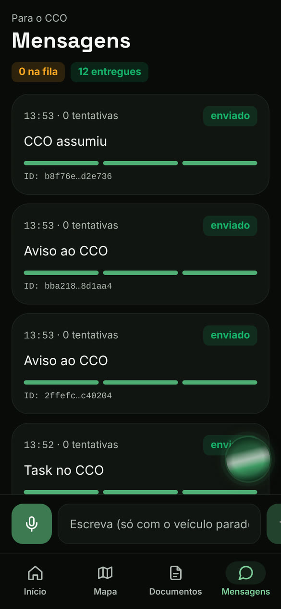
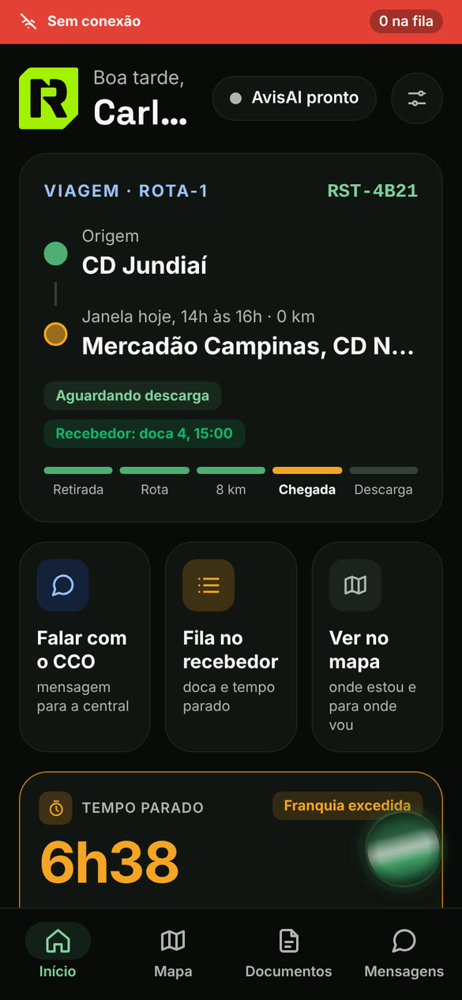
</details>

## Telas do aplicativo

<table>
  <tr>
    <td width="25%"><br /><sub><b>Login</b> · <code>LoginPage</code>: perfil e SSO simulado</sub></td>
    <td width="25%"><br /><sub><b>Início</b> · <code>TripPage</code>: próxima viagem</sub></td>
    <td width="25%"><br /><sub><b>Início</b> · viagem em andamento e etapas</sub></td>
    <td width="25%"><br /><sub><b>AvisAI</b> · esfera flutuante e painel de comandos</sub></td>
  </tr>
  <tr>
    <td><br /><sub><b>Conversa</b> · tela cheia, modo viagem</sub></td>
    <td><br /><sub><b>Mapa</b> · <code>MapPage</code>: rota, chegada e Navegar</sub></td>
    <td><br /><sub><b>Aviso</b> · resposta do recebedor a 8 km</sub></td>
    <td><br /><sub><b>Chegada</b> · check-in e Prova da Espera</sub></td>
  </tr>
  <tr>
    <td><br /><sub><b>Fila no recebedor</b> · <code>QueuePage</code>: doca, tempo parado e estadia</sub></td>
    <td><br /><sub><b>Documentos</b> · <code>DocumentsPage</code></sub></td>
    <td><br /><sub><b>Documento</b> · <code>DocumentViewerPage</code>: campos verificados</sub></td>
    <td><br /><sub><b>Mensagens</b> · <code>MessagesPage</code>: envios ao CCO (outbox)</sub></td>
  </tr>
  <tr>
    <td><br /><sub><b>Sem conexão</b> · faixa da fila offline</sub></td>
    <td>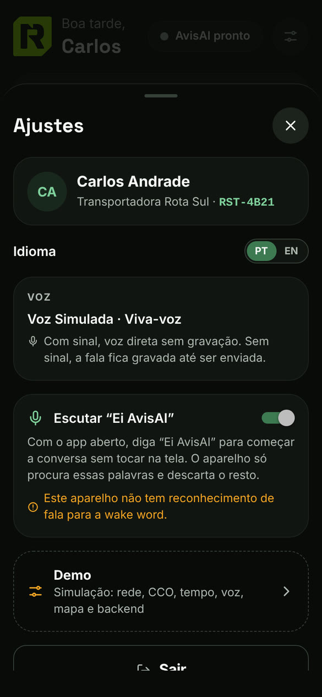<br /><sub><b>Ajustes</b> · <code>SettingsSheet</code>: idioma, voz, gravação sem sinal, "Ei AvisAI" e Demo</sub></td>
    <td colspan="2" valign="top"><sub>Os controles da demo (rede, CCO, tempo, voz, mapa e backend) abrem em Ajustes e no Mapa, com borda tracejada.<br /><br />O visual segue os mockups do repositório web (<a href="https://github.com/rodarglobal/rodar-web/tree/main/docs/RODAR-telas/aplicativo"><code>rodar-web/docs/RODAR-telas/aplicativo/</code></a>) e a paleta de <a href="docs/DESIGN.md">DESIGN.md</a>. Ainda sem tela no app, porque dependem de funções que não existem: login por SMS, checklist de saída em 5 passos, modo viagem curva a curva e chamada de voz com o CCO.<br /><br />Capturas do app real no modo Mock, rodando no navegador em 390 × 844 só para a gravação. No celular, o mapa usa o Google Maps quando há chave. Para regerar as telas e o tour: <code>./scripts/readme-captures/capture.sh</code>.</sub></td>
  </tr>
</table>

## Comandos de voz e wake word

**Wake word:** com o app aberto, logado e sem conversa ativa, diga **"Ei AvisAI"**. O painel do AvisAI abre e a conversa começa sem tocar na tela. Usa o reconhecedor de fala padrão do Android (`expo-speech-recognition`, serviço do Google) em modo contínuo: o app abre o microfone uma vez e o Android não toca o bipe a cada frase (o indicador de microfone em uso fica aceso enquanto escuta). O reconhecimento sem internet fica desligado (`WAKE_WORD.preferOnDevice`): no Galaxy A17 o modelo "instalado" devolvia texto vazio. O texto serve só para achar a wake word e é descartado. A escuta para durante a conversa e em segundo plano, e liga/desliga em **Ajustes → Escutar "Ei AvisAI"**. Precisa do Dev Build (não roda no Expo Go).

**Comandos durante a conversa:** o agente entende o pedido e o backend manda a ação ao app (`acao_cliente` no `/ws`):

| Fale | O app |
|---|---|
| "abre o mapa", "vai pras mensagens", "mostra os documentos", "abre a fila do recebedor", "volta pro início" | abre a tela |
| "mostra a nota fiscal", "abre o CT-e", "abre o comprovante de pesagem" | abre o documento |
| "volta" | volta uma tela |
| "tchau, AvisAI", "pode encerrar a conversa" | o agente se despede e a conversa encerra |
| "sair da conta" | o agente pede confirmação; depois do "sim", sai da conta |
| "me leva até o recebedor", "abre o Waze" | abre a rota até o destino no app de mapas |
| "liga o GPS" | liga o GPS do aparelho |
| "avisa o CCO que vou parar pra almoçar" | manda o recado ao CCO (problema, como fila ou avaria, vira ocorrência) |
| "repete", "o que eu perdi?" | o agente repete os últimos avisos |

**Telas de leitura só com o caminhão parado:** documentos e mensagens pedidos por voz com o caminhão andando ficam esperando; abrem sozinhos quando ele para, e o agente avisa isso em vez de dizer "abrindo".

**Avisos com a conversa fechada:** quando o agente precisa falar e não há conversa aberta (aproximação, resposta do CCO ou do recebedor, rota nova, pergunta da central), o backend manda `aviso_motorista` pelo `/ws`. O app fala o aviso em voz local (`expo-speech`, sem gastar minutos da Agora), mostra na tela e, se for pergunta, abre a conversa para o motorista responder. A wake word pausa enquanto o aviso é falado.

**Sem rede:** nenhum modelo de voz roda no celular. Com a conversa aberta, cada fala vira um áudio WAV, separado só pelo volume do microfone (`features/voice/rules/speechSegmenter.ts`, parâmetros em `OFFLINE_VOICE`). O app confirma em voz local, guarda a fala na fila e, quando a rede volta, envia para `POST /rotas/{id}/falas-offline`. O servidor transcreve e o agente responde com um aviso.

No modo de voz simulado (sem backend), as mesmas frases dos chips viram as mesmas ações (`services/voiceCommands.ts`).

## Rodar localmente

Use Node.js 20 LTS e npm. O jeito mais rápido é o Expo Go, no modo Mock (sem backend):

```bash
npm install
npx expo install --fix
npx expo start
```

Abra o QR code no Expo Go. O app detecta os módulos nativos que faltam e cai para o equivalente simulado: Agora → voz Mock, Google Maps → mapa SVG.

```bash
npm run lint
```

```bash
npm run typecheck
```

```bash
npm test
```

O CI do GitHub roda os três a cada push e PR.

| Ajuste | Valores | O que muda |
|---|---|---|
| `EXPO_PUBLIC_API_MODE` | `mock` (padrão) · `http` | `mock` roda a operação no aparelho, com dados fictícios. `http` usa o [rodar-backend](https://github.com/rodarglobal/rodar-backend): rota, eventos, ligação ao recebedor e stream `/ws`. |
| `EXPO_PUBLIC_VOICE_MODE` | `mock` (padrão) · `agora` | `mock` usa frases prontas e `expo-speech`. `agora` conecta o RTC ao agente Conversational AI configurado no backend (só no Dev Build). |
| `EXPO_PUBLIC_AUTH_MODE` | `mock` (padrão) · `keycloak` | `mock` entra pelo SSO do `ApiClient`. `keycloak` faz login OIDC (Authorization Code + PKCE) no Keycloak do [rodar-keycloak](https://github.com/rodarglobal/rodar-keycloak); configure `EXPO_PUBLIC_KEYCLOAK_ISSUER` (IP da máquina, ou `localhost` com `adb reverse tcp:8180 tcp:8180`). Exige Dev Build novo (`expo-web-browser`). |
| `GOOGLE_MAPS_API_KEY_ANDROID` | vazia (padrão) · chave | Sem chave, mapa SVG simulado. Com chave, Google Maps no Dev Build. |

Tudo isso também muda **em tempo real** pelo painel **Demo** (Ajustes ou botão Demo do Mapa), sem reiniciar o Metro.

<details>
<summary><strong>Dev Build Android via Docker + USB</strong></summary>
<br />

Toda a infraestrutura de desenvolvimento e build Android roda isolada em containers Docker (`Dockerfile.dev` com Node 20 LTS e `Dockerfile.android` com JDK 17 + Android SDK 35 + NDK 26):

```bash
# Instalar dependências, validar TypeScript e rodar os testes (Node 20 LTS no container)
./scripts/android-dev.sh install
./scripts/android-dev.sh typecheck
./scripts/android-dev.sh test

# Subir o Metro Dev Client na porta 8081
./scripts/android-dev.sh metro
```

Para testar os módulos nativos (`react-native-agora`, `react-native-maps`, `expo-dev-client`, wake word e voz sem rede) num celular Android via cabo USB:

```bash
# 1. (Opcional) Copie .env.example para .env e preencha as variáveis desejadas
cp .env.example .env

# 2. Gere o APK de desenvolvimento (build/avisai-dev-debug.apk)
./scripts/android-dev.sh build-apk

# 3. Verifique o celular conectado via USB (depuração USB ativa)
./scripts/android-dev.sh devices

# 4. Instale o APK no aparelho e configure adb reverse tcp:8081 tcp:8081
./scripts/android-dev.sh install-apk

# 5. Inicie o Metro Dev Client
./scripts/android-dev.sh metro
```

Alternativa em nuvem: o `eas.json` traz os perfis `development` (Dev Client APK), `preview` (APK interno) e `production`.

```bash
npx eas-cli build --profile development --platform android
```
</details>

<details>
<summary><strong>Regerar as telas e o tour do README</strong></summary>
<br />

```bash
./scripts/readme-captures/capture.sh
```

O script monta uma cópia temporária do projeto, instala ali o suporte web do Expo, troca os módulos nativos por stubs (como no Expo Go) e percorre o app no Chromium em 390 × 844, em pt-BR e no modo Mock. As telas e o tour (GIF e MP4) saem em `docs/assets/readme/`. O projeto em si não muda. Precisa de Playwright com Chromium e de ffmpeg; leva cerca de 4 min. O roteiro está em `scripts/readme-captures/tour.mjs`: se uma tela mudar de lugar, ajuste ali.
</details>

<details>
<summary><strong>Conectar ao backend RODAR e à voz Agora</strong></summary>
<br />

Configure a `.env` local (nunca versionada, **E7**):

```dotenv
EXPO_PUBLIC_API_MODE=http
EXPO_PUBLIC_API_BASE_URL=http://localhost:8000
EXPO_PUBLIC_ROTA_ID=1
EXPO_PUBLIC_VOICE_MODE=agora
GOOGLE_MAPS_API_KEY_ANDROID=
```

**Pelo túnel `trycloudflare.com`:**

1. No [rodar-backend](https://github.com/rodarglobal/rodar-backend), suba a API FastAPI na porta `8000` com o túnel Cloudflare (`https://xxxx.trycloudflare.com`) e rode o seed (`python -m app.seed`).
2. No app, abra **Demo**, alterne **API: Backend** e **Voz: Agora**, cole a URL do túnel em **URL do Backend** e toque em **Testar** (`GET /health` → `Online` e `WS conectado`).
3. Toque na esfera do AvisAI e no microfone para iniciar a sessão real (`POST /sessions`) e conversar com o agente no canal RTC (`uid 1001` motorista ↔ `uid 9001` agente).

**Acesso:** no modo `http`, o login guarda em memória o JWT devolvido pelo `/auth/sso` e o manda como `Authorization: Bearer` em toda chamada; ao sair, o token é apagado.

**Contrato.** `src/services/httpApi.ts`, `src/services/backendStream.ts` e `src/types/backend.ts` concentram o contrato HTTP/WS. A URL configurada aponta para a raiz do backend, sem acrescentar `/api`.

| Grupo | Rotas consumidas pelo app | Finalidade |
|---|---|---|
| Disponibilidade e perfil | `GET /health`, `GET /usuarios?role=driver`, `POST /auth/sso` | verifica a API, lista perfis de demonstração e seleciona a identidade do motorista |
| Rota atribuída | `GET /api/route?driverId={id}` ou `?tripId={id}`; `GET /rotas/{id}` | consulta autoritativa da viagem e seu detalhe |
| Tempo real | `WS /ws?motorista_id={id}` e `WS /ws?rota_id={id}` | recebe novas atribuições e atualizações de rota; após reconectar, o app faz refetch |
| Voz Agora | `POST /sessions`, `DELETE /sessions/{id}`, `POST /sessions/{id}/speak`, `GET /token?channel=&uid=` | cria/encerra a sessão e renova o token RTC |
| GPS e operação | `POST /rotas/{id}/posicao`, `/chegada`, `/descarga` | envia posição e registra os marcos operacionais autorizados pelo motorista |
| Falas sem rede | `POST /rotas/{id}/falas-offline` (multipart) | sobe os áudios gravados sem sinal; o arquivo local é apagado na confirmação (200 ou 409) |
| Documentos | `GET /api/documents?tripId={id}`, `GET /rotas/{id}/arquivos`, `/arquivos/{arquivoId}/download` | separa NF-e/CT-e MOCK dos anexos reais recebidos do CCO |
| Histórico | `GET /events?tripId={id}&since=...` | recupera a timeline normalizada para sincronização |

O mobile **não** publica rota, atribui motorista, confirma Task do CCO, chama o recebedor nem chama reset para obter sua viagem. Com `AUTH_OBRIGATORIA=true` (padrão do backend), toda escrita exige o JWT do `/auth/sso` e o motorista só age na rota atribuída a ele (403 na rota de outro). O login continua sem senha e as leituras seguem abertas; o que falta para produção está no [README do backend](https://github.com/rodarglobal/rodar-backend#o-que-falta-para-produção).

- **Google Maps (`GOOGLE_MAPS_API_KEY_ANDROID`):** lida em tempo de build pelo `app.config.ts` para injetar `android.config.googleMaps.apiKey` somente quando não-vazia, expondo apenas o booleano `extra.hasGoogleMapsKey` para o runtime JS. Se a chave ou o módulo nativo não estiverem presentes, `RouteMap` faz fallback automático para `RouteMapSvg`.
- **Voz Agora (`EXPO_PUBLIC_VOICE_MODE=agora`):** `AgoraVoiceSession` (`react-native-agora`) aplica os parâmetros `aplicarAudioIA` recomendados pela Agora (`AudioScenarioAiClient`, `ChannelProfileLiveBroadcasting`, AEC/AINS baixa latência), conecta o RTC ao agente configurado no backend, processa eventos de estado/interrupção/métricas e evita TTS local. Solicita permissão `RECORD_AUDIO`, renova token via `GET /token`, detecta barge-in por volume/fala local e expõe controles de **Mudo** e **Encerrar sessão**.
</details>

## O que é simulado

Todos os controles de simulação ficam isolados no componente `DemoControls` (identificado com **borda tracejada** na interface), aberto em **Ajustes** e no botão **Demo** do Mapa (**E8**):

- **SSO:** login sem senha, com perfis fictícios. No modo `http`, o backend devolve um JWT assinado. Com `EXPO_PUBLIC_AUTH_MODE=keycloak`, o login é real (OIDC + PKCE) num Keycloak local com usuários de teste fictícios, sem HTTPS nem hostname fixo; o access token vai como Bearer, mas o backend ainda não o valida.
- **Mapa:** `RouteMap` usa `RouteMapGoogle` (`react-native-maps` com `PROVIDER_GOOGLE` e estilo escuro) quando `GOOGLE_MAPS_API_KEY_ANDROID` está configurada no Dev Build, e cai para `RouteMapSvg` (mapa simulado em SVG) sem chave ou em modo SVG.
- **GPS e relógio:** o simulador percorre a polilinha da rota em tempo acelerado (`1 s real = 1 min simulado`), com atalhos na demo (`+1 h`, `Ir p/ Aproximação (8 km)`, `Ir p/ Chegada`). O GPS real do celular pode ser ligado na demo e envia a posição para `POST /rotas/{id}/posicao`.
- **Voz:** `VoiceSession` tem dois adapters:
  - `MockVoiceSession`: frases rápidas bilíngues (`pt-BR` / `en`) + síntese de voz `expo-speech` + barge-in + medição de latência.
  - `AgoraVoiceSession`: conexão RTC via `react-native-agora` integrada ao Conversational AI Engine pelo backend (com fallback automático para Mock sem módulo nativo, sem backend ou sem permissão de microfone).
- **Recebedor:** no modo `mock`, respostas sorteadas (confirma doca e horário, não recebe hoje, não atende); no modo `http`, o backend liga (`POST /rotas/{id}/ligar-recebedor`) e a resposta chega em tempo real pelo `/ws` (`resposta_recebedor`).
- **Rede:** a demo simula rede real, fraca (só eventos críticos sobem) ou sem rede.
- **Documentos:** NF-e e CT-e são MOCK; os anexos do CCO são reais quando baixados do backend. Visualizador local, indexação vetorial local em SQLite (embedding determinístico de 64 dimensões + similaridade cosseno) e resposta estrita por campos extraídos (**R7**).
- **Servidor:** a fila offline-first em SQLite (`outbox` + `events` + `settings`) é real, com `idempotencyKey` e ordem FIFO estrita; o transporte alterna entre `mockApi.ts` e `httpApi.ts` + stream `backendStream.ts` (`/ws`).
- **Fila no recebedor:** a posição na fila e os outros caminhões do mockup não aparecem; o recebedor ainda não informa a fila. A tela mostra a doca confirmada, o tempo parado e a estadia.
- **Navegar:** abre o app de mapas do aparelho com o destino da rota (não é simulado).
- **Rota, placa, empresas e telefones:** 100% fictícios (`Carlos Andrade`, `Transportadora Rota Sul`, `RST-4B21`, `CD Jundiaí` → `Mercadão Campinas, CD Norte`).

Regras completas: [REGRAS-DE-NEGOCIO.md](docs/REGRAS-DE-NEGOCIO.md). Parâmetros: `src/lib/config.ts`. A estadia segue a mesma fórmula do painel:

```text
ceil(max(0, espera_em_min / 60 − 5)) × toneladas × R$ 2,50
```

## Segurança e privacidade

- **Zero segredos no repositório (E7):** `.env`, chaves `.keystore`/`.jks`, `google-services.json` e artefatos `.apk`/`.aab` estão no `.gitignore`. Só o `.env.example`, com placeholders vazios, é versionado.
- **Chave do Google Maps fora do bundle JS:** `app.config.ts` injeta `GOOGLE_MAPS_API_KEY_ANDROID` só no manifesto nativo Android durante o prebuild; o `extra` expõe apenas `hasGoogleMapsKey: boolean`.
- **Voz com rede (`VOICE_PRIVACY`):** voz RTC direta com o agente. O app não grava o áudio (`recordAudio: false`) e não mostra nem consome a transcrição (`showTranscript: false`).
- **Voz sem rede (`OFFLINE_VOICE`):** com a conversa aberta e sem sinal, o app grava cada fala em WAV na pasta `falas_offline/` do app, só até o envio. O arquivo é apagado quando o servidor confirma o recebimento (**R6**, **R8**).
- **Wake word:** o texto reconhecido serve só para achar "Ei AvisAI" e é descartado.

## Arquitetura do app

Expo SDK 52, React Native 0.76, TypeScript, NativeWind, React Navigation, zustand, i18next (pt-BR e en) e expo-sqlite. Os testes usam Vitest.

```text
src/
├── app/                 bootstrap, providers e navegação
├── pages/               Login, Início, Mapa, Documentos, Documento, Mensagens, Fila no recebedor e Ajustes
├── features/            um domínio por pasta; só o index.ts é público
│   ├── auth/            seleção de perfil e SSO MOCK
│   ├── trip/            rota, geocerca, estadia, escalonamento, mapa e controles da demo
│   ├── voice/           sessões Mock/Agora, esfera do AvisAI, conversa e voz sem rede
│   ├── documents/       documentos, busca local e respostas por campo
│   ├── report/          campos obrigatórios do reporte por voz
│   └── outbox/          fila offline FIFO e sincronização
├── services/            clientes HTTP/mock, WebSocket, GPS do aparelho, rede e agentBus
├── components/          componentes de interface reutilizáveis
├── lib/                 configuração, SQLite, i18n e IDs
├── types/               eventos, rota e contratos do backend
├── utils/               geografia, formatação, haptics e texto
└── __tests__/           testes Vitest das regras e integrações de cliente
```

As dependências seguem `pages → features → components/lib/services/utils/types`. As features expõem só o `index.ts`; `trip` e `voice` trocam eventos pelo `src/services/agentBus.ts`, sem importação circular. As cores vêm só dos tokens (`tailwind.config.js`, [DESIGN.md](docs/DESIGN.md)) e todos os textos passam pelo i18n. Detalhes em [ARQUITETURA.md](docs/ARQUITETURA.md).

<details>
<summary><strong>Dependências e componentes preexistentes (E5)</strong></summary>
<br />

Nenhum código proprietário anterior ao hackathon foi usado. Só pacotes open-source públicos, fixados para o **Expo SDK 52** (`package.json`):

- **Core:** Expo SDK 52 (`~52.0.37`), React `18.3.1`, React Native `0.76.7`, TypeScript `~5.3.3`, `expo-dev-client`, `expo-build-properties`, `expo-constants`.
- **Voz e RTC:** `react-native-agora` (`^4.5.1`), `expo-speech` (`~13.0.1`), `expo-speech-recognition` (`^1.1.1`, wake word), `@fugood/react-native-audio-pcm-stream` (`^1.1.4`, microfone da voz sem rede), `react-native-fs` (`^2.20.0`, arquivos das falas sem rede).
- **Mapa, GPS e UI:** `react-native-maps` (`1.18.0`), `expo-location`, `expo-task-manager`, `react-native-svg` (`15.8.0`), NativeWind `^4.1.23` + Tailwind CSS `^3.4.17`, React Navigation v7, `react-native-reanimated` (`~3.16.1`), `react-native-safe-area-context`, `react-native-screens`.
- **Dados, estado e i18n:** `expo-sqlite` (`~15.1.2`), `zustand` (`^5.0.3`), `i18next` (`^24.2.2`), `react-i18next` (`^15.4.0`), `expo-localization` (`~16.0.1`), `expo-crypto` (`~14.0.2`), `@react-native-community/netinfo` (`11.4.1`).
- **Testes:** `vitest` (`^3.0.5`).
</details>

## Documentação

- [Arquitetura e fluxos](docs/ARQUITETURA.md)
- [Regras de negócio](docs/REGRAS-DE-NEGOCIO.md)
- [Design system](docs/DESIGN.md)
- [Mockups das telas do app](https://github.com/rodarglobal/rodar-web/tree/main/docs/RODAR-telas/aplicativo) (no rodar-web)

## Licença e versão

[MIT](LICENSE) · **v0.1.0** (tag `v0.1.0-entrega` quando a entrega for fechada)

**Histórico:** o projeto começou como *AvisAI* no hackathon UNMUTE by Agora (21–22/11/2026) e continua como **RODAR** no Hack Brasil 2026, na trilha Logística & automação. Os repositórios foram criados em 22/11/2026 e todo o histórico de commits está neles; o AvisAI virou o nome do agente de voz do RODAR.

Repositórios: [rodar-backend](https://github.com/rodarglobal/rodar-backend) · [rodar-web](https://github.com/rodarglobal/rodar-web) · este (rodar-mobile).
