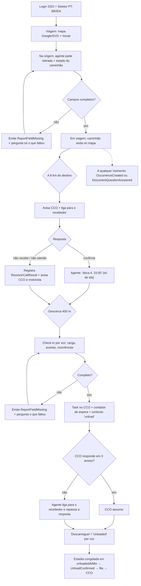
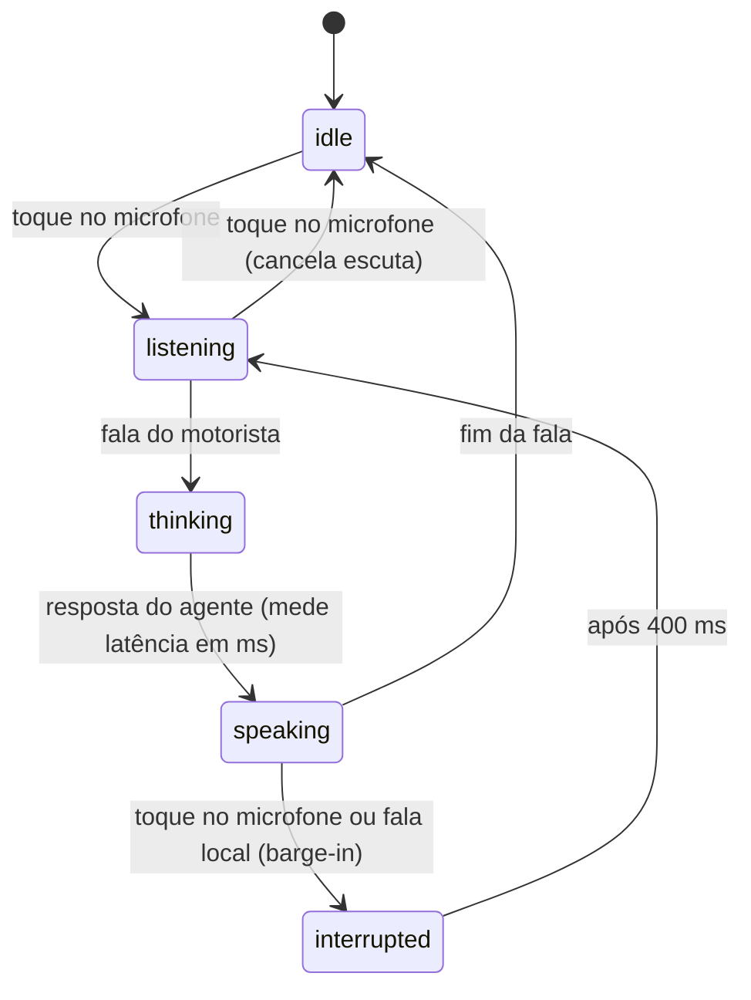

# AvisAI Mobile — Arquitetura

Expo SDK 52 + React Native 0.76 + TypeScript + NativeWind 4 (Tailwind 3.4) + i18next (`pt-BR` e `en`) + zustand + expo-sqlite + `react-native-agora` + `react-native-maps`. Suporta **Android Dev Build** (com módulos nativos Agora RTC e Google Maps) e fallback automático para rodar sem backend/chaves ou no Expo Go. Plano geral: `docs/arquitetura-avisai.md` no repositório de ideias.

## Estrutura (feature/domínio)

```
src/
├── __tests__/      # Testes unitários Vitest: stay, escalation, requiredFields, documents, geo
├── app/            # App.tsx (providers + gate de migração), navigation.tsx (tabs com ícones SVG + badge), bootstrap.ts
├── assets/locales/ # pt-BR.json, en.json (100% espelhados, zero texto hardcoded)
├── components/     # UI genérica: Button, Card, Badge, Screen, NetworkBanner, LanguageSwitch
├── features/
│   ├── auth/       # SSO via ApiClient (useSession, SsoButton)
│   ├── trip/       # rota mock, simulador de GPS e relógio, geocerca, aproximação, escalonamento, estadia
│   │   ├── components/ # RouteMap (ErrorBoundary), RouteMapGoogle, RouteMapSvg, StayCounter, TripStatusCard, DemoControls
│   │   └── rules/  # stay.ts (estadia Lei 11.442/2007), escalation.ts (canais e tentativas)
│   ├── voice/      # VoiceSession, MockVoiceSession (expo-speech), AgoraVoiceSession (react-native-agora), voiceFactory
│   ├── report/     # campos obrigatórios por momento e extração bilíngue pt-BR/en (rules/requiredFields.ts)
│   ├── outbox/     # fila offline FIFO em SQLite + motor de sincronização (syncEngine.ts)
│   └── documents/  # PDFs mock, viewer mock, busca vetorial local em SQLite por trip_id, respostas só por campo (R7)
├── hooks/
├── lib/            # config.ts (BUSINESS, TIME_SCALE, VOICE_PRIVACY, ENV), db.ts (SQLite + migração + settings), i18n.ts, id.ts
├── pages/          # LoginPage, TripPage, DocumentsPage, DocumentViewerPage, OutboxPage
├── services/       # apiClient.ts, httpApi.ts, mockApi.ts, api.ts, network.ts (NetInfo + simulação), agentBus.ts
├── types/          # events.ts (contrato de eventos, igual ao web), geo.ts
└── utils/          # geo.ts (haversine, ponto na rota), format.ts (moeda/hora localizadas), text.ts
```

Regra de dependência: `pages` → `features` → (`components`, `lib`, `services`, `utils`, `types`). Uma feature só usa outra pelo `index.ts`. `trip` e `voice` conversam pelo `agentBus` (sem import circular).

## Adapters Mock × Real (Dev Build)

| Peça | Modo Mock / Fallback (`mock`) | Modo Real (`http` / `agora` / Dev Build) |
|---|---|---|
| Mapa | `RouteMapSvg` em SVG com rota, geocercas e caminhão | `RouteMapGoogle` (`react-native-maps` `PROVIDER_GOOGLE`, tema escuro `ink-950`, mesmas coordenadas) com fallback automático em `RouteMap` |
| GPS | simulador percorre a polilinha (`startTripSimulator`) + atalhos de demo (`+1 h`, `8 km`, `Chegada`) | `expo-location` + rastreador |
| Voz | `MockVoiceSession`: falas prontas bilíngues (chips) + `expo-speech` (TTS) + barge-in; latência medida | `AgoraVoiceSession`: `react-native-agora` no canal RTC do Conversational AI Engine (`onStreamMessage` + `onAudioVolumeIndication`) com `voiceFactory` |
| Agente | `agentMock.ts` bilíngue (`pt-BR`/`en`) com as regras R1–R9 | LLM no Conversational AI Engine da Agora iniciado via `POST /agent/start` (`transcriptionOnly: true`, `recordAudio: false`) |
| Recebedor | `mockApiClient.callReceiver()` com resposta simulada após 2,5 s | `httpApiClient.callReceiver()` → `POST /call/receiver` (SIP de saída) |
| PDF | `MockPdfViewer` (páginas em texto) | visualizador nativo |
| Busca vetorial | embedding determinístico por hash (64 dimensões) + cosseno em JS sobre `chunks` filtrados por `trip_id` | embeddings do modelo real, mesma tabela |
| Servidor | `mockApiClient` (latência, falha, idempotência em memória, `receivedAt`) | `httpApiClient` (`fetch` + `AbortController` 8 s + header `Idempotency-Key` via `EXPO_PUBLIC_API_BASE_URL`) |
| SSO | `mockApiClient.ssoLogin()` | `httpApiClient.ssoLogin()` / OIDC |

## Infraestrutura Docker & Android Dev Build

- `Dockerfile.dev`: Node 20 LTS para instalação de pacotes, validação TypeScript (`tsc --noEmit`), testes unitários (`vitest run`) e servidor Metro (`expo start --dev-client`).
- `Dockerfile.android`: Node 20 + OpenJDK 17 + Android SDK 35 + NDK 26.1 para `expo prebuild --platform android` e `./gradlew assembleDebug`, gerando `build/avisai-dev-debug.apk`.
- `scripts/android-dev.sh`: CLI unificada (`install`, `typecheck`, `test`, `build-apk`, `devices`, `install-apk`, `metro`).

## Dados locais (SQLite)

| Tabela | Para quê |
|---|---|
| `outbox` | fila de envio estritamente FIFO: `status` (`pending`, `sending`, `sent`, `failed`), `attempts`, `next_try_at`, `idempotency_key` única |
| `events` | espelho local dos eventos da viagem com `occurred_at` (celular) e `received_at` (servidor) para prova jurídica (**R6**) |
| `documents`, `chunks` | documentos da viagem (`trip_id`) e trechos com embedding (JSON validado) para a busca vetorial |
| `settings` | preferências locais persistidas (ex.: idioma `lang` = `pt-BR` ou `en`) |

## Fluxos

### Operação no app



### Fila offline (FIFO estrito)

```mermaid
stateDiagram-v2
  [*] --> pending: enqueue() grava em events + outbox (idempotencyKey)
  pending --> sending: cabeça da fila (next_try_at <= now) e rede ok (ou fraca + crítico)
  sending --> sent: 200/201 ou 409 (salva received_at em events)
  sending --> pending: erro (attempts++, espera 2^n s, máx. 60 s; bloqueia fila para manter FIFO)
  sending --> pending: resetStuckSending() no bootstrap
  pending --> failed: attempts > 8
  failed --> pending: "Tentar de novo"
  sent --> [*]
```



### Voz (estados)



## Roteiro da demo (2 min)

1. Login SSO (escolha `PT-BR` ou `EN`) → Iniciar viagem.
2. `"Peguei a carga"` → agente registra `ReportFieldMissing` e pergunta só do caminhão (recuperação de campo faltante).
3. Atalho `"Ir p/ Aproximação (8 km)"` → agente liga para o recebedor e avisa `"doca 4, 15:00"`.
4. Controles: **Sem rede** → falar `"Tem um acidente no km 230"` → banner e badge da aba Fila mostram `"1 na fila"` → **Rede real** → sincroniza em ordem FIFO.
5. Atalho `"Ir p/ Chegada"` → `"Cheguei, carga ok"` → agente pergunta avarias/ocorrências → `"Sem avaria, viagem tranquila"` → completo → contador de espera inicia e contexto muda para descarga (`unload`).
6. CCO não responde: `+1 h` → escala 1/3 (`push`), 2/3 (`painel`), 3/3 (`ligação`) → agente liga para o recebedor e repassa a resposta.
7. Tocar no microfone enquanto o agente fala (barge-in) → `"Descarreguei"` → estadia calculada e congelada com badge de descarga concluída.
