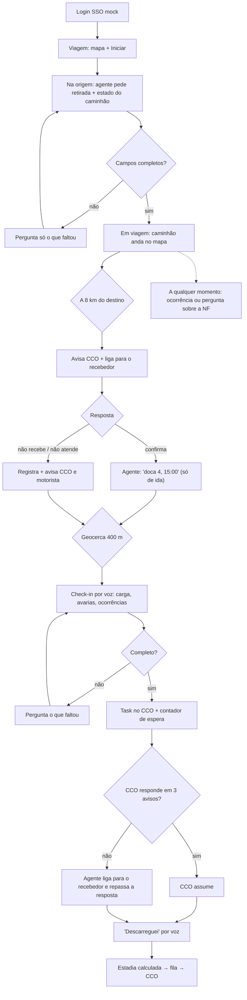
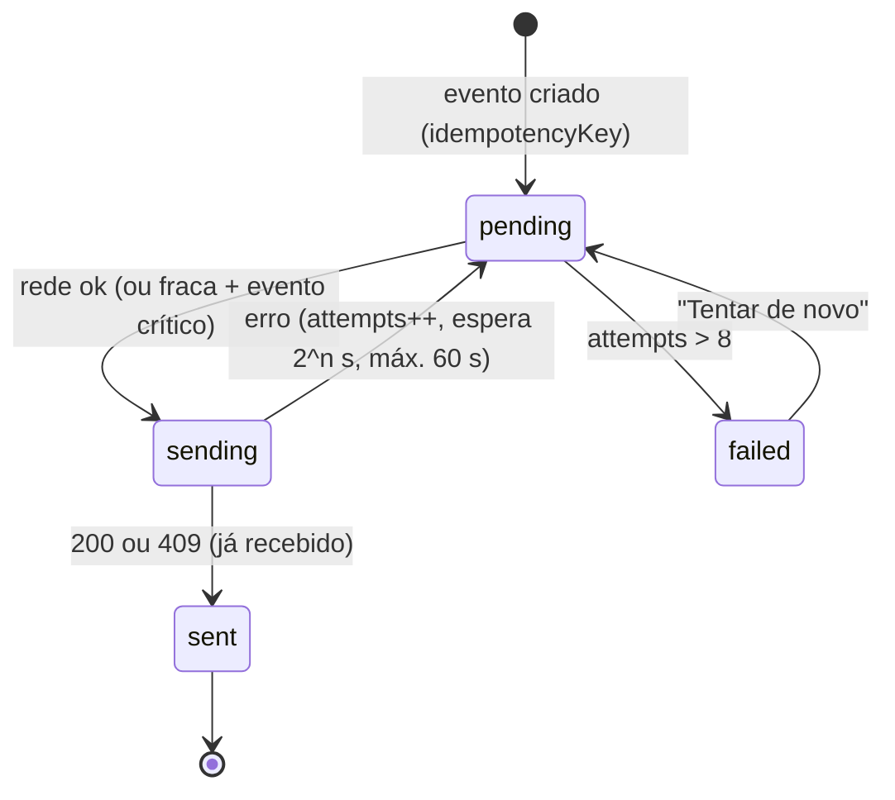
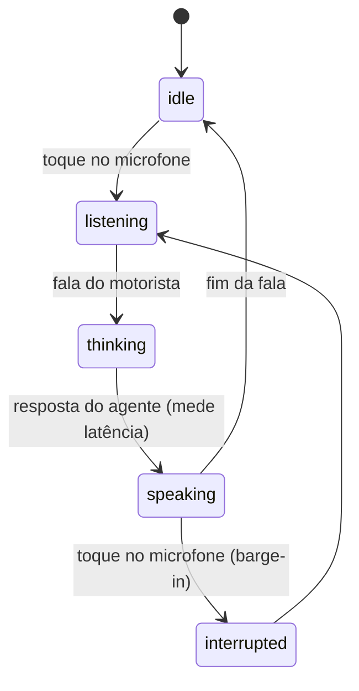

# AvisAI Mobile — Arquitetura

Expo + React Native + TypeScript + NativeWind (Tailwind) + i18next + zustand + expo-sqlite. **Roda no Expo Go**: mapa, PDF, voz e servidor são mock. Plano geral: `docs/arquitetura-avisai.md` no repositório de ideias.

## Estrutura (feature/domínio)

```
src/
├── app/            # App.tsx (providers), navigation.tsx, bootstrap.ts (liga banco, rede, fila, simulador, voz)
├── assets/locales # pt-BR.json, en.json
├── components/     # UI genérica: Button, Card, Badge, Screen, NetworkBanner
├── features/
│   ├── auth/       # SSO genérico mock (useSession, SsoButton)
│   ├── trip/       # rota mock, simulador de GPS e relógio, geocerca, aproximação, escalonamento, estadia
│   │   └── rules/  # stay.ts (estadia), escalation.ts (canais e tentativas)
│   ├── voice/      # estados da voz, agente mock, transcrição, microfone, barge-in, TTS (expo-speech)
│   ├── report/     # campos obrigatórios por momento e extração (rules/requiredFields.ts)
│   ├── outbox/     # fila offline em SQLite + motor de sincronização
│   └── documents/  # PDFs mock, viewer mock, busca vetorial local em SQLite, respostas só por campo
├── hooks/
├── lib/            # config.ts (regras e parâmetros), db.ts (SQLite + migração), i18n.ts, id.ts
├── pages/          # LoginPage, TripPage, DocumentsPage, DocumentViewerPage, OutboxPage
├── services/       # network.ts (NetInfo + simulação), mockApi.ts (servidor mock), agentBus.ts
├── types/          # events.ts (contrato de eventos, igual ao web), geo.ts
└── utils/          # geo.ts (haversine, ponto na rota), format.ts, text.ts
```

Regra de dependência: `pages` → `features` → (`components`, `lib`, `services`, `utils`, `types`). Uma feature só usa outra pelo `index.ts`. `trip` e `voice` conversam pelo `agentBus` (sem import circular).

## Mock × real

| Peça | Agora (mock, Expo Go) | Depois (dev build) |
|---|---|---|
| Mapa | `RouteMap` em SVG com rota, geocercas e caminhão | `react-native-maps` com `PROVIDER_GOOGLE`, mesmas coordenadas |
| GPS | simulador percorre a polilinha (`startTripSimulator`) | `expo-location` + rastreador |
| Voz | falas prontas (chips) + `expo-speech` para o TTS; latência medida | `react-native-agora` no canal do Conversational AI (`VoiceSession`) |
| Agente | `agentMock.ts` com as mesmas regras do prompt | LLM no Conversational AI Engine da Agora |
| Recebedor | `callReceiver()` com resposta aleatória após 2,5 s | `POST /call/receiver` (SIP de saída) |
| PDF | `MockPdfViewer` (páginas em texto) | `react-native-pdf` |
| Busca vetorial | embedding por hash (64 dimensões) + cosseno em JS sobre `chunks` no SQLite | embeddings do modelo real, mesma tabela |
| Servidor | `mockApi.ts` (latência, falha, idempotência) | `agent-server` via `EXPO_PUBLIC_API_BASE_URL` |
| SSO | `ssoLogin()` mock | `expo-auth-session` (OIDC) |

## Dados locais (SQLite)

| Tabela | Para quê |
|---|---|
| `outbox` | fila de envio: `status` (pending, sending, sent, failed), `attempts`, `next_try_at`, `idempotency_key` única |
| `events` | espelho local dos eventos da viagem (a tela não depende da rede) |
| `documents`, `chunks` | documentos da viagem e trechos com embedding (JSON) para a busca vetorial |

## Fluxos

### Operação no app



### Fila offline



### Voz (estados)



## Roteiro da demo (2 min)

1. Login SSO → Iniciar viagem.
2. "Peguei a carga" → agente pergunta só do caminhão (recuperação de campo faltante).
3. Caminhão chega a 8 km → agente liga para o recebedor e avisa "doca 4, 15:00".
4. Controles: **Sem rede** → falar "Tem um acidente no km 230" → banner "1 na fila" → **Rede real** → sincroniza.
5. Chegada → "Cheguei, carga ok" → agente pergunta avarias/ocorrências → completo → contador.
6. CCO não responde: +1 h algumas vezes → 3/3 → agente liga para o recebedor e repassa.
7. Tocar no microfone enquanto o agente fala (barge-in) → "Descarreguei" → estadia calculada.
