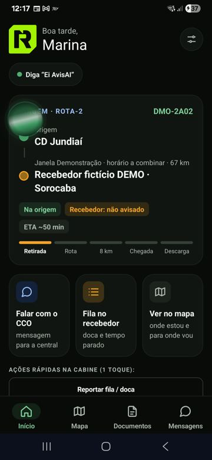
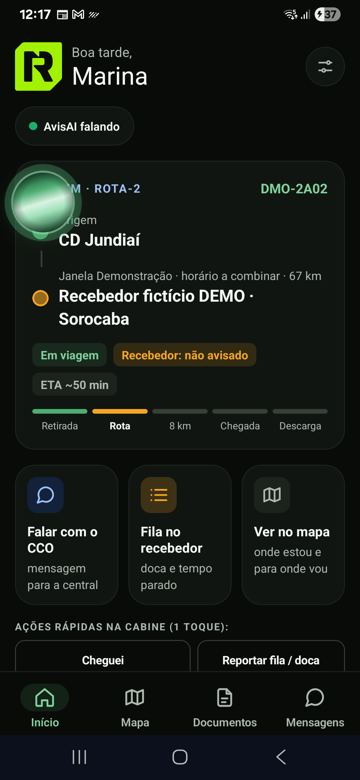
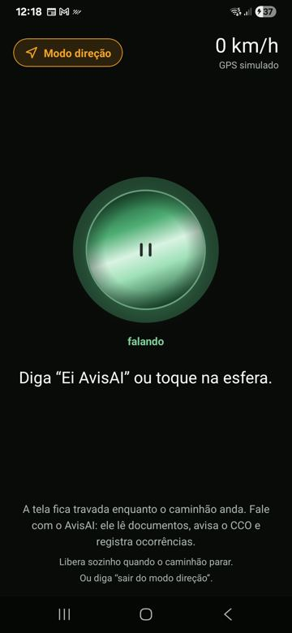
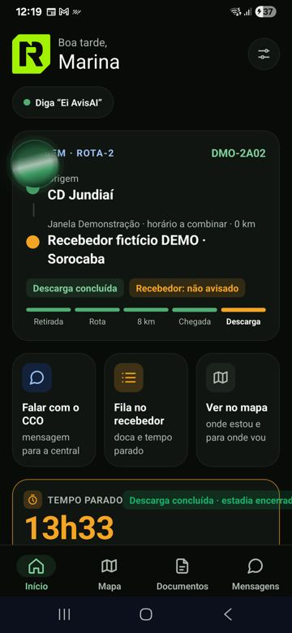

# Teste ponta a ponta no celular

**Status: pronto e passando (20 de 20 etapas)**, em 28/11/2026, num Samsung Galaxy A15 (Android 14) com o Dev Build, a voz LiveKit real e o backend local.

Este teste cobre o que os testes unitários e o tour Mock não cobrem: o app nativo no aparelho, com o microfone de verdade, conversando com o agente LiveKit e mudando o estado no backend. O painel do CCO lê o mesmo backend. Todas as etapas da viagem do motorista são feitas **por voz**, sem tocar na tela depois de abrir o AvisAI.

| Início da viagem | Modo direção (voz) | Chegada | Descarga |
|---|---|---|---|
|  |  |  |  |

## Como rodar

```bash
# 1. Backend local (no rodar-backend): API, banco, agente de voz e túnel
docker compose up -d

# 2. Celular por USB com depuração ativa e o Dev Build instalado (ver "Rodar localmente" no README)
#    .env do app: EXPO_PUBLIC_API_MODE=http, EXPO_PUBLIC_API_BASE_URL=http://<IP do computador>:8000,
#    EXPO_PUBLIC_VOICE_MODE=livekit
npm start

# 3. Em outro terminal, com o celular perto do alto-falante do computador
python3 scripts/e2e/celular.py --sink <id do alto-falante em `wpctl status`>
```

O script ([`scripts/e2e/celular.py`](../scripts/e2e/celular.py)) só usa a biblioteca padrão do Python, além de `adb`, `docker` e `pw-play` (PipeWire). Ele leva cerca de 3 min. O relatório e as capturas saem em `e2e-resultados/<data-hora>/`, uma pasta ignorada pelo git.

**Como a "fala do motorista" é feita.** O script gera cada frase com o TTS do LiveKit Inference, dentro do container do agente ([`scripts/e2e/tts.py`](../scripts/e2e/tts.py)), e toca o áudio no alto-falante do computador. O microfone do celular capta a fala como se fosse o motorista, e ela passa pelo mesmo caminho de uma voz humana: WebRTC → LiveKit → STT → LLM → ferramenta no backend. Se o STT não entender uma frase, o script tenta uma segunda frase antes de reprovar a etapa. A voz sintética do sistema (`spd-say`/espeak) não serve para isso, porque o STT erra quase tudo.

**A Task fica com o CCO.** Logo depois da chegada, o script assume a Task como CCO (`POST /tasks/{id}/confirmar`). Isso testa a ação da central e interrompe o escalonamento. Se ninguém assumir, o backend local com Twilio configurado chega a fazer uma **ligação telefônica real** no terceiro nível.

## O que o teste confere

| # | Etapa | Como confere |
|---|---|---|
| 1-4 | Backend com LiveKit, celular por USB, app instalado e Metro no ar | `GET /health`, `adb devices`, `pm list packages`, `GET :8081/status` |
| 5 | Rota volta ao início | `POST /rotas/{id}/reset` → `planejada` |
| 6 | Login e "Iniciar viagem" pelo app | evento `RouteAssigned` vindo do outbox do app |
| 7 | O agente LiveKit entra na sala do motorista | evento `sessao_iniciada` |
| 8 | Retirada por voz | rota `em_transito` (ferramenta `confirmar_retirada`) |
| 9 | Relatório inicial por voz | evento `relatorio` |
| 10 | Aproximação pela geocerca, falada pelo agente | evento `aproximacao` (GPS simulado do backend) |
| 11 | Chegada pela geocerca e Task assumida pelo CCO | rota `no_destino` e Task `confirmada` |
| 12 | Chegada confirmada por voz | evento `chegada_confirmada_voz` |
| 13 | Check-in por voz | evento `relatorio` |
| 14 | Descarga por voz | rota `descarregada` e estadia calculada pelo backend |
| 15 | Saída do agente encerra a conversa no app | `DELETE /sessions/{id}` → `disconnect from room` no app |
| 16 | O app mostra a estadia final do backend | o tempo parado da descarga aparece na tela |
| 17 | Nenhum alerta crítico falso | nenhum `alerta_motorista` crítico para "sem avaria" ou "nenhum problema" |
| 18 | A voz não caiu durante a viagem | nenhum `disconnect from room` fora do encerramento pedido |
| 19 | Sem ligação real | nenhuma decisão de ligação PSTN |
| 20 | Estadia vinda do backend | a mensagem da descarga traz o valor |

Na rodada de 28/11, o painel web em modo API (**Conectar à API**, no mesmo backend) mostrou a viagem com o estado `descarregada`, a estadia de R$ 405,00 e a linha do tempo com as falas do motorista e do agente.

## O que o teste achou (e foi corrigido)

1. **A voz caía a cada aviso proativo (mobile).** Para o agente falar sem ser perguntado (aproximação, chegada, lembrete do CCO), o backend entra na sala como `rodar-control-…`, manda o pedido e sai em ~150 ms. O app tratava a saída de *qualquer* participante como "o agente saiu" e encerrava a conversa do motorista. Agora só o agente abre ou encerra a conversa (`features/voice/rules/agentParticipant.ts`, com teste).
2. **Agente antigo preso na sala (backend).** `remove()` usava `api.RemoveParticipantRequest`, que não existe na livekit-api 1.x. A remoção falhava em silêncio, e o agente de uma sessão já encerrada continuava na sala, respondendo com a sessão vencida (`404` em `/v1/voice/tool`, e o agente dizia "houve um problema ao registrar sua chegada"). Agora usa `api.RoomParticipantIdentity` (com teste).
3. **Alerta crítico falso ao CCO (backend).** O classificador das falas não tratava negação: "sem avaria" e "não teve nenhum problema" viravam "Motorista relatou um problema na rota" com prioridade crítica, em todo check-in limpo. Agora a negação sai antes da classificação, e "sem problema, mas o pneu furou" continua crítico (com teste).
4. **Estadia final atrasada na tela (mobile).** Depois da descarga, o contador ficava no último tique (por exemplo, 20h07) em vez do valor fechado pelo backend (20h19). Agora o app usa a estadia que vem no próprio evento `descarga` (com teste).

Um falso alarme também ficou registrado: com a esfera animando, o `uiautomator` não consegue ler a tela (`could not get idle state`) e devolve o XML anterior. Isso fez parecer que a retirada não atualizava o app. O script apaga o XML antes de cada leitura.

## Limites

- O GPS da viagem é o simulado do backend (`simular_rota.py`), declarado em [O que é simulado](../README.md#o-que-é-simulado). O GPS real do aparelho não entra neste teste.
- A voz do "motorista" é sintética, tocada perto do microfone. O teste prova o caminho de áudio real (microfone → LiveKit → agente), mas não a robustez do STT com ruído de cabine.
- Ele roda contra o backend local, não contra a AWS pública, e precisa de um celular físico. Por isso não está na CI.
